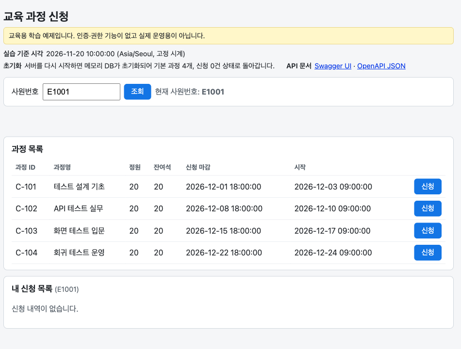
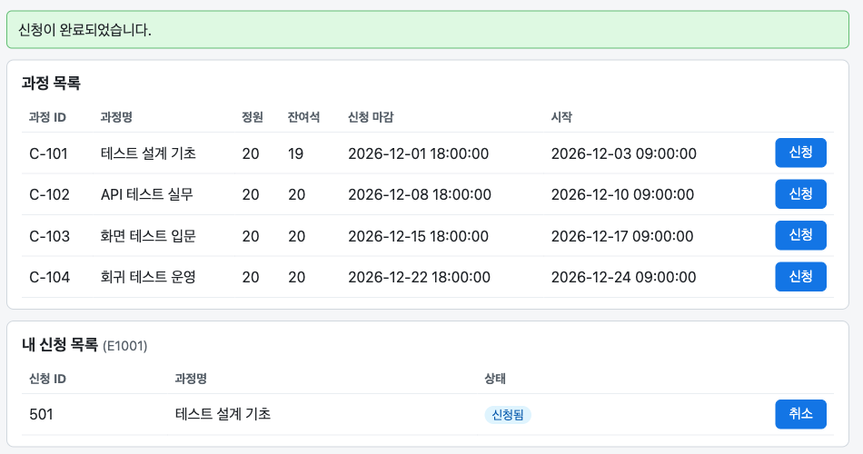

# 교육 신청·취소 앱 이해와 설계 구조 안내

이 문서는 **준비된 앱의 현재 소스·요구 문서·API 계약을 읽어 이번 소개를 위해 새로 작성한 안내**입니다. 개발 전에 작성된 원 설계서가 아닙니다. 예상 결과의 기준은 [요구와 합의 규칙](requirements.md)이며, 현재 구현과 실행 관찰은 그 기준과 비교할 대상입니다. 이 안내에는 완성 답안 테스트를 넣지 않았습니다.

## 1. 앱의 목적과 사용자

학생 예제: [GitHub 공개 저장소](https://github.com/frentis-edu-code/course-enrollment-testing-student). README에서 **Code → Download ZIP**으로 받고 프로젝트 루트의 실행 안내를 따릅니다. 질문과 합의부터 신청·취소 규칙, API, 화면, 기준 데이터, 추가 결정, 인수조건까지 요구 전체는 [requirements.md](requirements.md)에 있습니다.

사원은 원하는 사내 교육 과정에 신청해 자리를 확보하고, 참석할 수 없으면 신청을 취소해 다른 사람에게 자리를 돌려줍니다. 교육 담당자의 요구 메모가 업무 배경이며, 별도의 담당자 관리 화면은 없습니다. 학생은 이미 준비된 Java/Spring Boot + React 앱을 사용하고 테스트합니다. 빈 프로젝트부터 앱 전체를 개발하는 실습이 아닙니다.

- 과정 목록: 이름·정원·잔여석·신청 마감·시작 시각을 보고 신청합니다.
- 내 신청 목록: 사원번호로 조회하고, 신청 ID·과정명·신청됨/취소됨 상태를 봅니다. 신청됨만 취소 버튼을 보여 줍니다.
- 결과 안내: 신청·취소의 성공 안내 또는 서버 오류 메시지를 화면 위쪽에서 확인합니다.
- 실습 정보: 고정 시계와 초기화 방법, API 문서 링크를 제공합니다.

사원번호 E1001 등은 교육용 값입니다. 로그인·인증·권한·사원 존재 확인은 없습니다. 실제 개인정보나 업무 서비스를 연결하지 않습니다.

## 2. 실제 화면으로 따라 읽는 정상 흐름

아래는 학생 공개판을 별도 사본에서 빌드하고 실행한 실제 화면입니다. 캡처는 빈 loopback 포트 54775를 사용했습니다. 본인 앱의 기본 주소는 `http://127.0.0.1:8080/`입니다. 화면 안에는 개인 폴더 경로나 계정 정보가 없습니다. 확대 이미지는 같은 원본의 해당 영역을 잘라 낸 것입니다.

### ① 사원번호 조회와 과정 목록

E1001로 조회합니다. 새 서버는 C-101~C-104 네 과정, 각 정원·잔여석 20, 신청 0건입니다. C-101은 “테스트 설계 기초”입니다.



[전체 화면](images/01-course-list.png)에서 실습 기준 시각과 교육용 안내도 확인할 수 있습니다.

### ② 과정 신청과 내 신청 확인

C-101 행의 `신청` 버튼을 누릅니다. 실제 관찰은 성공 안내, C-101의 잔여석 **20 → 19**, 내 신청의 **신청됨(APPLIED)**입니다. API에서도 C-101 신청 인원 1, 잔여석 19, E1001 신청됨 한 건을 확인했습니다. 다른 과정의 잔여석은 20입니다.



[전체 화면](images/02-applied.png). 화면의 신청 ID 501은 이번 실행에서 얻은 값입니다. 테스트에서 특정 ID에 기대지 말고 응답이 반환한 ID를 사용합니다.

### ③ 취소 확인과 좌석 반환

내 신청의 `취소`를 누르면 실제 브라우저 확인 창에 **“정말 취소하시겠습니까?”**가 표시됩니다. 확인해야 취소 요청이 나갑니다. 창을 닫거나 취소하면 요청하지 않습니다. 이번 검증에서는 창에서 한 번 취소해 신청됨이 유지됨을 확인하고, 다시 눌러 확인한 뒤 아래 상태를 관찰했습니다. 확인 창 자체의 이미지 캡처는 브라우저 제한으로 확보하지 못했으며, 문구와 확인·취소 행동은 실제 도구 응답으로 확인했습니다.


실제 관찰은 C-101 신청 인원 **1 → 0**, 잔여석 **19 → 20**, 같은 신청 ID의 **취소됨(CANCELLED)**입니다. 기록을 삭제하지 않습니다. [전체 화면](images/04-cancelled.png)도 제공합니다. 재신청 시 새 ID를 만드는 것은 요구·소스에서 확인한 규칙이며, 이 캡처 흐름에서 재신청까지 실행한 것은 아닙니다.

## 3. 전체 요구사항을 읽는 지도

소개에서 요약한 범위는 아래 전체 묶음입니다. 대표 실습만 골랐다고 나머지 요구가 제외되는 것은 아닙니다. **정확한 조건·응답 코드·메시지·값은 [requirements.md](requirements.md) 전체를 읽습니다.** 아래 표의 절 번호는 원문 위치를 찾는 보조 표식입니다. [openapi.json](openapi.json)은 실제 요청·응답의 필드와 형식을 확인할 계약 파일입니다.

| 원문 절 | 전체 범위와 이 안내에서의 연결 |
| --- | --- |
| 1 입력 메모와 합의 | 온라인 신청·취소, 정원, 중복, 마감·취소 기한, 개인 한도. 정각 포함(Q1), 취소 후 재신청(Q2), 취소분 집계 제외(Q3), 시작 24시간 전(Q4), 신청됨 3개(Q5), 첫 위반 순서(Q6), 입력·과정 존재(Q7). 아래 신청·취소 규칙 설명에서 조건과 결과를 읽습니다. |
| 2 용어 | 과정·신청, 과정별 신청 인원·사원별 보유 신청 수, 잔여석, 서버 요청 시각과 초 단위. 아래 도메인 클래스와 데이터 설명에서 관계·집계를 읽습니다. |
| 3 신청 규칙 | 필수 입력·과정 존재·마감·중복·개인 한도·정원·첫 위반 순서(R1~R7). 201 새 신청, 거절 시 데이터 불변. 아래 신청 규칙 설명에서 조건과 순서를 읽습니다. |
| 4 취소 규칙 | 신청 존재·상태·기한·확인 순서(C1~C4). 200 상태 변경·즉시 좌석 반환·보유 수 감소, 재신청은 새 ID·신청 규칙 재적용. 아래 취소 규칙·도메인·취소 시퀀스 설명과 연결합니다. |
| 5 API 계약 | 과정 조회, 신청, 취소, 내 신청 목록(취소됨 포함, 신청 ID 순), 실습 정보. 아래 조회·신청·취소 시퀀스와 소스 참고 지도에서 요청 흐름을 읽습니다. |
| 6 화면 | 정원 마감 표시·버튼 비활성과 서버 재확인, 결과 안내, 내 신청·취소 확인 창, 기준 시각·인증 없음 안내. 위 실제 실행 화면에서 표시와 동작을 살펴봅니다. |
| 7 기준 데이터 | C-101~C-104의 이름·정원·신청 마감·시작·취소 기한 전체 표, 시작 신청 0건, 예제 사원 E1001~E1030. 원문의 네 과정 표를 함께 봅니다. |
| 8 추가 결정 | 아래 별도 목록의 입력·오류·사원번호·시계·ID·동시 처리 전 항목. |
| 9 유저스토리와 인수조건 | US-1 신청: AC1-1 정상 접수·좌석 감소, AC1-2 정원, AC1-3 중복·재신청, AC1-4 마감, AC1-5 한도, AC1-6 이유·순서. US-2 취소: AC2-1 기한·정각, AC2-2 좌석 반환·다른 사원 접수, AC2-3 이미 취소됨, AC2-4 기한 초과 안내. 자동 테스트 통과와 업무 담당자의 인수 승인은 다릅니다. |

### 요구 문서 8절의 추가 결정 전체

- 깨진 JSON·본문 없음·필드 타입 불일치: 400 `INVALID_REQUEST`. 빈 객체·필드 누락은 R1의 400 `MISSING_FIELD`와 구분합니다.
- 숫자가 아니거나 범위를 넘는 신청 ID: 400 `INVALID_REQUEST`.
- JSON이 아닌 Content-Type: 415 `UNSUPPORTED_MEDIA_TYPE`.
- 없는 주소·허용하지 않는 메서드·예상하지 못한 서버 오류: 각각 404 `NOT_FOUND`, 405 `METHOD_NOT_ALLOWED`, 500 `INTERNAL_ERROR`.
- 오류 응답은 `{code, message}`만 반환하고 내부 정보를 넣지 않습니다.
- 사원 존재는 확인하지 않습니다. 비어 있지 않은 사원번호를 받습니다. 별도의 업무상 길이 규칙도 없고 저장 열은 H2 VARCHAR 최대 길이(1,000,000,000자)로 매핑되어 51자 이상도 받습니다.
- 사원번호·과정 ID는 앞뒤 공백을 잘라 같은 값으로 봅니다. 내 신청 조회에 사원번호가 없으면 400 `MISSING_FIELD`입니다.
- 요청 시각은 초 미만을 버립니다. `18:00:00.900`은 `18:00:00`으로 비교합니다.
- 신청 ID는 501부터 증가하지만 업무 의미가 없으며 테스트의 고정 예상값으로 쓰지 않습니다.
- 같은 서버 안에서 신청·취소를 한 번에 하나씩 처리합니다. 여러 서버의 동시 처리까지 보장하지 않습니다.

추가 결정도 요구의 일부이며 원문의 정확한 메시지와 계약을 기준으로 확인합니다. 현재 화면에서 직접 관찰하지 못한 오류 조건까지 통과했다고 판단하지 않습니다.

## 4. 신청·취소의 명확한 규칙

### 신청: 모두 통과해야 새 신청을 만든다

1. **R1 필수 입력**: 사원번호와 과정 ID가 모두 있어야 합니다. null·빈 문자열·공백만 있으면 누락입니다.
2. **R2 과정 존재**: 과정 ID로 찾은 과정이 있어야 합니다.
3. **R3 신청 마감**: 서버 요청 시각이 신청 마감 일시와 같거나 이전이어야 합니다.
4. **R4 중복 금지**: 같은 사원·같은 과정의 신청됨이 없어야 합니다. 취소됨은 중복이 아닙니다.
5. **R5 개인 한도**: 그 사원의 모든 과정 신청됨을 합해 3개 미만이어야 합니다.
6. **R6 정원**: 이번 과정의 신청됨 수가 정원보다 작아야 합니다.
7. **R7 확인 순서**: R1 → R2 → R3 → R4 → R5 → R6. 여러 조건을 어겨도 첫 번째 위반 하나만 알려 줍니다.

성공은 201과 새 신청됨 기록, 신청 인원 +1·잔여석 −1입니다. 거절되면 신청이 생기지 않고 데이터가 그대로입니다. 필수 입력은 400, 과정 없음은 404, 나머지 업무 충돌은 409입니다. 정확한 오류 코드와 한국어 메시지는 원문 3절에 있습니다.

### 취소: 존재 → 상태 → 기한

- **신청 존재(C1)**: 신청 ID가 가리키는 기록이 있어야 합니다(없으면 404).
- **신청 상태(C2)**: 신청됨이어야 합니다. 이미 취소됨이면 409입니다.
- **취소 기한(C3)**: 요청 시각 ≤ 시작 일시 − 24시간이어야 합니다. 정각도 포함하며 넘으면 409입니다.
- **확인 순서(C4)**: 신청 존재 → 신청 상태 → 취소 기한 순서로 확인합니다.

성공은 200, 같은 기록의 상태가 취소됨으로 바뀌며 좌석이 즉시 돌아옵니다. 과정 신청 인원과 사원 보유 수가 각각 1 줄어듭니다. 거절되면 상태·인원은 그대로입니다. 다시 신청하면 **새 신청 ID**를 만들고 R1~R7을 처음부터 적용합니다.

### 두 기한과 서버 시계

C-101의 신청 마감은 `2026-12-01 18:00:00`, 시작은 `2026-12-03 09:00:00`, 취소 기한은 `2026-12-02 09:00:00`입니다. 모두 Asia/Seoul 기준이며 신청 마감과 취소 기한은 다른 시각입니다. 기본 서버의 요청 시각은 `2026-11-20 10:00:00`으로 고정되어 있습니다. 실제 오늘 날짜·교육 일정이 아닙니다. 테스트에서는 시계를 주입해 경계를 만듭니다.

## 5. 도메인 클래스 다이어그램으로 읽는 구조

클래스 상자는 업무 개념의 이름과 핵심 속성을 나누어 보여 줍니다. 관계선 양 끝의 `1`은 한 개, `0..*`는 없거나 여러 개를 뜻합니다.

```text
┌──────────────────────────────┐          ┌─────────────────────────────┐
│ 과정 Course                  │          │ 신청 Enrollment             │
├──────────────────────────────┤ 1   0..* ├─────────────────────────────┤
│ 과정 ID · 과정명 · 정원       ├──────────┤ 신청 ID · 사원번호 · 과정 ID │
│ 신청 마감 일시 · 시작 일시    │          │ 상태 APPLIED / CANCELLED    │
└──────────────────────────────┘          └─────────────────────────────┘
```

하나의 과정에는 신청이 없거나 여러 건 연결됩니다. 신청 한 건은 한 과정을 가리킵니다. 취소 후 재신청은 새 기록이므로 같은 사원·과정에도 취소된 기록과 새 신청 기록이 함께 있을 수 있습니다.

이것은 **업무상 관계를 설명하는 개념 모델**입니다. 현재 JPA 구현은 `Enrollment.courseId` 문자열을 보관하며 `@ManyToOne` 객체 관계로 매핑하지 않습니다. 사원번호도 문자열 속성이고 별도 `Employee` 엔티티나 사원 테이블은 없습니다.

- 과정의 신청 인원 = 해당 과정의 `APPLIED` 기록 수.
- 사원의 보유 신청 수 = 해당 사원의 모든 과정 `APPLIED` 기록 수.
- 잔여석 = 과정 정원 − 과정의 신청 인원. 잔여석은 별도 저장 속성이 아니라 조회 시 계산합니다.
- 취소는 같은 신청을 `CANCELLED`로 바꾸고 보존합니다. 정원·개인 한도 집계에서는 제외합니다.
- H2 메모리 DB는 서버 재시작 시 초기화됩니다. `SeedData`가 네 과정을 넣고 기본 신청은 없습니다.

화면·API·서비스·규칙 객체·저장소는 서로 다른 책임입니다. 서비스는 입력·존재·시간·집계·저장을 조율하고 규칙 객체는 주어진 값으로 판단합니다. 규칙 객체가 DB나 시계를 직접 읽지 않습니다. 같은 서버의 쓰기는 `ReentrantLock` 안에서 트랜잭션 시작부터 커밋까지 직렬화합니다. 목록 조회는 잠그지 않고 커밋된 값을 읽습니다. 여러 서버에 걸친 보장은 하지 않습니다.

## 6. 조회·신청·취소의 시퀀스

세로 생명선은 참여자가 처리에 관여하는 시간을, 위에서 아래는 메시지의 순서를 나타냅니다. 실선 화살표는 요청, 점선 화살표는 응답입니다. 교재는 한눈에 흐름을 보기 위해 API와 서비스, Repository와 DB를 각각 묶어 표현합니다. 실제 파일 분리는 다음 절에서 찾습니다.

### 조회: 상태를 읽고 목록을 만든다

1. React가 `GET /api/courses`를 보냅니다. 서비스는 신청됨 수를 과정별로 집계하고 과정 목록을 과정 ID 순으로 읽습니다. 집계가 없는 과정의 신청 인원은 0입니다.
2. `remainingSeats = capacity - appliedCount`로 잔여석을 계산하고 API가 200 목록 응답을 보냅니다.
3. 내 신청은 별도 `GET /api/enrollments?employeeId=E1001`입니다. 서비스는 과정명과 해당 사원의 신청을 읽고 취소됨까지 포함해 신청 ID 순으로 반환합니다. 사원번호 누락은 400입니다.
4. 두 GET은 서로 독립적입니다. 교재의 위아래 배치는 설명 순서이며 React가 반드시 차례대로 기다린다는 뜻은 아닙니다. 화면에서는 병렬로 재조회합니다.
5. `GET /api/lab-info`는 별도 경로입니다. `LabInfoController`가 `LabTime`·`LabProperties`를 읽으며 신청 서비스·규칙 객체·DB를 거치지 않습니다.

### 신청: 조건을 확인하고 새 기록을 만든다

1. React가 `POST /api/enrollments`에 `{employeeId, courseId}`를 보냅니다.
2. 서비스가 규칙 객체로 R1 필수 입력을 확인하고 앞뒤 공백을 정리합니다. R2 과정 존재를 확인하고 시각·중복·개인 수·과정 수를 준비합니다.
3. 규칙 객체가 주어진 값으로 마감·중복·개인 한도·정원을 확인합니다(R3~R6). 처음 위반한 규칙 하나로 거절하며 새 신청을 저장하지 않습니다(확인 순서 R7).
4. 통과하면 새 `APPLIED` 신청을 저장하고 **커밋 후** 201 `{enrollmentId, courseId, status}`를 반환합니다. 취소된 기록을 되살리지 않습니다.
5. React가 고정된 성공 문구를 표시합니다. 오류일 때는 서버의 `{code, message}` 중 메시지를 표시합니다. 성공·실패 모두 마지막에 과정·내 신청 목록을 병렬 재조회합니다.

### 취소: 같은 기록의 상태를 바꾼다

1. React가 “정말 취소하시겠습니까?” 확인 창을 띄웁니다. 확인해야 `POST /api/enrollments/{enrollmentId}/cancel`을 본문 없이 보냅니다. 확인하지 않으면 요청하지 않습니다.
2. 서비스가 신청 존재(C1)와 그 신청의 과정 정보를 읽고, 규칙 객체가 상태·기한(C2·C3)을 확인합니다(C4 순서).
3. 통과하면 같은 신청을 `CANCELLED`로 저장하고 커밋 후 200 `{enrollmentId, status}`를 반환합니다. 신청 행을 삭제하지 않습니다.
4. React가 성공 안내를 표시하고 두 목록을 재조회합니다. 신청됨 집계에서 빠져 잔여석이 1 늘고, 취소됨 기록은 내 목록에 남습니다. 거절 시 상태·인원은 그대로입니다.
5. 재신청은 새 신청 요청이며 그 시점의 입력·과정 존재·마감·중복·개인 한도·정원을 처음부터 다시 확인합니다(신청 규칙 R1~R7).

정확한 HTTP 필드와 형식은 [openapi.json](openapi.json), 실행 앱의 `/swagger-ui/index.html`·`/v3/api-docs`에서 확인합니다.

## 7. 실제 파일 지도

Java 경로의 공통 앞부분은 `src/main/java/com/example/enrollment/`입니다.

| 이해할 내용 | 실제 파일·위치 |
| --- | --- |
| 원래 짧은 메모 / 합의 규칙 / API 계약 | `docs/requirements-memo.md` / `docs/requirements.md` / `docs/openapi.json` |
| React 진입 / 화면 / HTTP 호출 / 스타일 | `frontend/src/main.jsx` / `App.jsx` / `api.js` / `styles.css` |
| 프론트 빌드·개발 프록시 / E2E 실행 | `frontend/package.json`, `vite.config.js`, `playwright.config.js` |
| Java 앱 시작 | `CourseEnrollmentApplication.java` |
| 과정·신청·실습 정보 API 입구 | `web/CourseController.java`, `EnrollmentController.java`, `LabInfoController.java` |
| 입력·응답·오류 형태 | `web/EnrollmentRequest.java`, `CourseResponse.java`, `MyEnrollmentResponse.java`, `EnrollmentResponse.java`, `CancelResponse.java`, `LabInfoResponse.java`, `ErrorResponse.java` |
| 오류 응답 변환 | `web/ApiExceptionHandler.java`, `service/BusinessRuleException.java`, `rules/ErrorCode.java` |
| 신청·취소 처리·집계 준비·저장·동시 처리 | `service/EnrollmentService.java` |
| 주어진 조건의 규칙 판단과 입력 자료형 | `rules/EnrollmentRules.java`, `EnrollmentCheck.java` |
| 과정·신청·상태와 조회 | `domain/Course.java`, `Enrollment.java`, `EnrollmentStatus.java`, `CourseRepository.java`, `EnrollmentRepository.java` |
| 시계와 초 단위 변환 | `config/LabClockConfig.java`, `LabProperties.java`, `service/LabTime.java` |
| 기준 데이터·API 문서 설정 | `config/SeedData.java`, `OpenApiConfig.java` |
| 메모리 DB·loopback 주소·기본 포트·시계 설정 | `src/main/resources/application.properties` |
| Java 의존성과 화면을 jar에 넣는 빌드 | `pom.xml`, `mvnw` / `mvnw.cmd` |

## 8. 실행과 테스트 위치

### 문서의 역할과 테스트 시작 상태

앱 소스 `src/main/java/`와 `frontend/src/`는 이미 구현된 예제입니다. 요구 문서는 예상 결과를 정하는 기준, 설계 안내는 앱의 업무·구조를 읽는 자료, AI 공통 안내는 AI가 먼저 읽는 위치·보호 조건, AI 요청문은 이번 작업을 시작하는 요청, 실습 진행 안내는 생성·검토·실행 절차입니다. 작성한 테스트와 실행 결과를 서로 구분합니다.

Java 테스트 경로의 공통 앞부분은 `src/test/java/com/example/enrollment/`입니다.

| 실제 파일 | 처음 받은 상태 | 작성·사용하는 위치 | 실행 결과를 읽는 기준 |
| --- | --- | --- | --- |
| `practice/EnvironmentCheckTest.java` | 활성화된 환경 확인. `@Tag("smoke")` | 첫 준비: 앱 설정·테스트 도구 확인 | 환경 확인 성공이며 업무 규칙 전체 검증이 아님 |
| `practice/`의 새 `*Test.java` | 아직 없음. 예: `RulesCapacityTest.java`, `CancellationDeadlineTest.java`, `EnrollmentApiTest.java` | 단원 3 규칙 단위·TDD 연습, 단원 4 MockMvc API, 필요하면 실제 HTTP 인수 시나리오 | 이번에 만든 테스트만 실행 대상. 실행 수 0은 아직 실행된 테스트가 없다는 뜻 |
| `frontend/e2e/`의 새 `*.spec.js` | 아직 없음. 예: `enrollment-flow.spec.js` | 단원 4: 화면 E2E | Maven 실행과 별도로 `npm run e2e`. 파일이 없으면 실행할 화면 테스트가 없음 |
| `support/` 및 `frontend/e2e/helpers.js` | 시계·데이터·호출·화면 조작 준비 도구 | 필요한 검사에서 재사용 | 테스트 답안이나 이미 완료된 업무 검사가 아님 |
| `templates/java/`의 `RulesPracticeTest.java`·`ApiPracticeTest.java`·`AcceptancePracticeTest.java`, `templates/e2e/practice-flow.spec.js` | 예전 시작판의 미작성 틀(`@Disabled`·`test.fixme`, 미작성 `fail`)을 원본 그대로 보관 | 구조를 참고할 때만 읽음 | 실행 탐색 위치 밖이라 실행되지 않음. 활성 폴더로 복사하지 않음 |

미작성 틀을 실행 폴더에서 분리했으므로, 실행 결과에는 이번에 만든 테스트만 나타납니다. 미작성 `fail`이 실행되어 생긴 실패는 앱 결함도 의도한 TDD 실패도 아니므로 섞지 않습니다. 생성 파일 이름은 예시이며, AI가 다른 이름으로 만들었으면 실제 이름으로 읽습니다.

| 단계 | 확인할 결과 |
| --- | --- |
| 처음 환경 확인 | 환경 검사 결과와 실행 설정. 이를 앱 전체 품질로 확대하지 않음 |
| 미작성 틀 | skipped/disabled/fixme. 아직 검증하지 않은 범위이며 passed에 포함하지 않음 |
| 이번 작성 테스트 | 이번에 만든 assertion이 요구의 조건·응답·데이터 변화를 검사하는지, 선택 실행에서 실제 실행되었는지 확인 |
| 누적 완성 테스트 | 이전에 완성해 활성화한 검사까지 함께 재실행. 실제 실행·실패·건너뜀 수를 각각 기록 |
| TDD의 의도한 실패 | 새 요구를 표현한 완성 assertion이 기대한 이유로 실패하는지 확인. 미작성 `fail`, 컴파일 오류, 서버 연결 실패와 구분 |

아래 실행 명령은 태그로 실행 범위를 고릅니다. 태그를 골랐다는 사실만으로 그 범위의 테스트가 모두 작성·실행된 것은 아닙니다. 콘솔과 `target/surefire-reports/`의 실제 executed/skipped 결과를 읽습니다.

### 기본 실행 순서

[README의 준비 환경과 앱 실행](../README.md#준비-환경과-앱-실행)을 기준으로 합니다. `pom.xml`, `mvnw`, `frontend`가 있는 곳이 프로젝트 루트입니다.

```bash
# 프로젝트 루트에서
java -version
node --version
cd frontend
npm ci
npm run build
cd ..
./mvnw clean package
java -jar target/course-enrollment-testing-0.1.0.jar
```

Windows PowerShell에서는 Maven 명령을 `.\mvnw.cmd clean package`로 바꿉니다. JDK 21, Node.js 22.12.0 이상을 준비합니다. 화면 빌드는 `frontend/dist`, jar는 `target/course-enrollment-testing-0.1.0.jar`에 생깁니다. `pom.xml`이 `frontend/dist`를 jar의 정적 자원으로 넣으므로 기본 실행에는 별도 Vite 서버가 필요하지 않습니다. `npm run dev`는 개발용 별도 방식이며 앞 명령의 필수 단계가 아닙니다.

터미널에 앱 시작 로그가 나온 뒤 `http://127.0.0.1:8080/`에서 제목·기준 시각·네 과정이 보이고 조회가 되면 화면이 준비된 것입니다. 그 터미널은 켜 둡니다. 8080이 사용 중이면 **본인 앱에만** `--server.port=8081`을 붙이고 접속 주소도 8081로 바꿉니다. 다른 사람의 서버를 종료하지 않습니다. 종료는 본인이 실행한 터미널의 Ctrl+C를 사용합니다. 재시작하면 신청 데이터가 사라집니다.

### 학생이 테스트를 만들 위치

Java 공통 앞부분: `src/test/java/com/example/enrollment/`.

| 단원 | 입력·생성 위치 | 실행·읽을 결과 |
| --- | --- | --- |
| 1 | 앱 화면·메모, 이 안내. 확인하고 싶은 상황과 이유 | 정상 흐름의 안내·상태·잔여석을 직접 관찰 |
| 2 | `docs/requirements.md`의 해당 절 → AI가 케이스 표 생성. `docs/worksheets/02-테스트케이스-설계.md`는 선택 참고 | 마감 시각·예상 응답·데이터 변화를 요구에 대조 |
| 3 | practice에 새로 만드는 규칙 테스트(예: `RulesCapacityTest.java`): Spring·DB 없이 규칙 객체. TDD는 practice의 새 연습 클래스(예: `CancellationDeadline.java`·`CancellationDeadlineTest.java`) | `./mvnw test -Dgroups=unit` → 콘솔·`target/surefire-reports/` |
| 4 | practice에 새로 만드는 API 테스트(예: `EnrollmentApiTest.java`): `ApiTestSupport`로 Spring·DB를 잇는 MockMvc | `./mvnw test -Dgroups=api` 등 교재의 해당 명령 |
| 4 화면 | `frontend/e2e/`에 새로 만드는 Playwright 테스트(예: `enrollment-flow.spec.js`). `helpers.js`는 준비 도구 | jar·Chromium 준비 후 `frontend`에서 `npm run e2e` |
| 5 | `lab5-change.patch` 분석, 단원 4의 API 테스트에 재신청 테스트 보강, 실제 실행 기록 | 변경 전 기준선 → 변경 뒤 → 필요한 수정 뒤 재실행. 미실행은 그대로 보고 |

`practice/EnvironmentCheckTest.java`는 환경 확인이며, 업무 규칙 테스트는 실습에서 새로 만듭니다. 예전 미작성 틀은 `templates/`에 읽기 참고로만 있습니다. `support/`에는 테스트 시계·데이터·API 호출 도구가 있습니다. Maven 전체 실행은 Playwright를 실행하지 않습니다. 건너뜀을 기능 검증 통과로 세지 않습니다. 현재 요청과 안전 조건은 [AI 공통 안내](AI-공통-안내.md), [AI 요청문](AI-요청문.md), [실습 진행 안내](실습-진행-안내.md)를 따릅니다.

## 9. 이번 확인의 범위

학생 공개판의 별도 실행 사본에서 React 빌드, Maven 패키징, jar 실행, 브라우저 조회→신청→취소 확인→취소, API의 상태·집계 값을 확인했습니다. 기본 Maven 실행에서 환경 확인 1건 통과·빈 실습 4건 건너뜀을 확인했으며 이것을 업무 전체 테스트로 세지 않습니다. 이 관찰은 빈 틀이 practice와 frontend/e2e에 있던 공개판 기준입니다. 이 후보에서 빈 틀을 `templates/`로 옮긴 뒤 격리 실행 사본의 기본 Maven 테스트는 환경 확인 1건 실행·실패 0·건너뜀 0이었습니다. 4건 건너뜀이 사라진 이유는 틀을 실행 위치 밖으로 옮겼기 때문이며 업무 검사가 완성된 것은 아닙니다. Playwright는 다시 실행하지 않았습니다. 실제 화면 캡처와 로그를 근거로 한 정상 흐름 확인입니다.

이번 작업은 AI로 새 테스트를 생성하는 전체 실습, 모든 오류·경계·동시 조건의 실행, Playwright 학생 테스트 전체 실행, TDD·변경 패치의 종단 실습, 학생 PC 재현, 강사의 낭독·시간 리허설을 수행한 것이 아닙니다. 화면 확인과 자동 테스트 생성 실습 검증은 구분합니다.


## 10. 요구·화면·소스·이후 테스트의 대응

단원 1에서는 앱 목적·실행·실제 화면을 보고, 전체 요구 표와 도메인 클래스·조회/신청/취소 시퀀스로 업무의 구조와 동작을 이해합니다. 아래 표는 강의 중 파일을 하나씩 따라가는 절차가 아니라 필요한 때 소스를 찾는 참고자료입니다. 첫 열의 번호는 원문 위치를 찾는 보조 표식이며, 읽을 때는 같은 칸의 내용 이름을 기준으로 삼습니다. Q는 질문과 합의, R은 신청 규칙, C는 취소 규칙, US는 유저스토리, AC는 인수조건입니다. 인수조건 10개의 정확한 문장은 requirements.md의 유저스토리와 인수조건 절(9절)에 있습니다.

| 큰 요구·원문 | 화면에서 보는 것 | 실제 소스의 책임 | 이후 테스트와 연결 |
| --- | --- | --- | --- |
| 과정 조회: API 계약·화면(5·6절), 잔여석 정의는 용어(2절) | 과정·정원·잔여석·신청 마감·시작 | `frontend/src/App.jsx` → `api.js` → `web/CourseController.java` → `service/EnrollmentService.java` → `domain/CourseRepository.java`와 `EnrollmentRepository.java`. 신청됨 수를 조회해 잔여석 계산 | 단원 4 API·화면의 관찰값, 단원 5 조회 변경 영향 |
| 내 신청 조회: API 계약·화면(5·6절) | 사원번호 조회, 취소됨 포함 목록 | `App.jsx` → `api.js` → `web/EnrollmentController.java` → `service/EnrollmentService.java` → `domain/EnrollmentRepository.java`. 사원번호 누락 확인·공백 정리, ID 순 목록 | 단원 4 신청·취소 후 기록 확인, 단원 5 상태 조건 회귀 |
| 실습 정보: API 계약·화면(5·6절) | 기준 시각·고정 시계·초기화 안내 | `api.js` → `web/LabInfoController.java` → `service/LabTime.java`와 `config/LabProperties.java`. **신청 서비스·규칙 객체·DB를 거치지 않음** | 경계 실습의 시계 조건 확인. 업무 규칙 전체 검증으로 세지 않음 |
| 신청: 신청 규칙(R1~R7)·신청 인수조건(AC1-1~6) | 접수·거절 안내, 새 신청됨, 잔여석 감소 | `App.jsx` → `api.js` → `web/EnrollmentController.java` → `service/EnrollmentService.java`. 서비스가 입력·존재·집계·시각을 준비하고 `rules/EnrollmentRules.java`가 조건 판단. 통과 시 `domain/Enrollment.java`·`EnrollmentRepository.java`로 새 기록 | 단원 2 마감 케이스, 단원 3 규칙 단위 검사, 단원 4 API·화면, 단원 5 중복·한도 관련 조회 회귀 |
| 취소: 취소 규칙(C1~C4)·취소 인수조건(AC2-1~4) | 확인 창·취소됨 기록·좌석 반환 | `App.jsx`가 확인 창 수락 후 `api.js` 호출 → Controller → Service가 신청 존재 조회 → Rules가 상태·기한 판단 → 기존 Enrollment 상태 변경·Repository 저장. 재조회 집계에서 빠짐 | 단원 2 취소 기한 따라 하기, 단원 3 별도 TDD 연습, 단원 4 좌석 반환 API·화면, 단원 5 재신청 관련 회귀 |
| 잘못된 요청·오류 안내: 추가 결정(8절) | 오류 메시지, 내부 정보 없는 응답 | HTTP 형식·상태 처리는 Spring 웹 계층과 `web/ApiExceptionHandler.java`, 업무 충돌은 서비스·규칙의 첫 위반. 화면 `api.js`가 서버 오류 메시지를 전달 | 각 테스트 범위에서 입력·응답 계약 확인. 모든 오류가 업무 규칙 객체를 거친다고 가정하지 않음 |

### 부록: 질문 번호와 규칙의 연결

- 마감 정각 포함 합의(Q1) → 신청 마감 규칙(R3) → 정각 접수·초과 거절 인수조건(AC1-4).
- 취소 후 재신청 합의(Q2) → 취소됨은 중복이 아니라는 규칙(R4) → 중복·재신청 인수조건(AC1-3).
- 취소분 집계 제외 합의(Q3) → 정원 규칙(R6) → 정원 마감·취소 좌석 반환 인수조건(AC1-2·AC2-2).
- “하루 전”은 24시간이라는 합의(Q4) → 취소 기한 규칙(C3) → 기한 내 취소·초과 안내 인수조건(AC2-1·AC2-4).
- 신청됨 세 개 한도 합의(Q5) → 개인 한도 규칙(R5) → 한도 거절 인수조건(AC1-5).
- 첫 위반 하나 안내 합의(Q6) → 확인 순서 규칙(R7) → 이유·확인 순서 인수조건(AC1-6).
- 입력·없는 과정 합의(Q7) → 필수 입력·과정 존재 규칙(R1·R2). 취소의 존재·상태·기한·순서는 취소 규칙(C1~C4)에서 읽습니다.

### 큰 레이어와 다른 경로

```text
React 화면·api.js → web/Controller → service/EnrollmentService ↔ domain/Repository ↔ H2
                                               ↕
                                    rules/EnrollmentRules
                           (서비스가 준비한 값으로 판단, DB·시계 직접 조회 없음)

별도 실습 정보: api.js → web/LabInfoController → LabTime·LabProperties
```

규칙 객체가 저장소를 통과해 DB를 읽는 구조가 아닙니다. 조회 요청은 데이터를 읽고 계산하며, 신청·취소 요청은 필요한 상태를 읽어 판단한 뒤 저장합니다. 전체 구조도를 먼저 이해하고 조회·신청·취소의 대표 경로를 나누어 읽습니다. 함수별 문법이나 클래스의 모든 필드를 익히는 수업으로 범위를 넓히지 않습니다.
